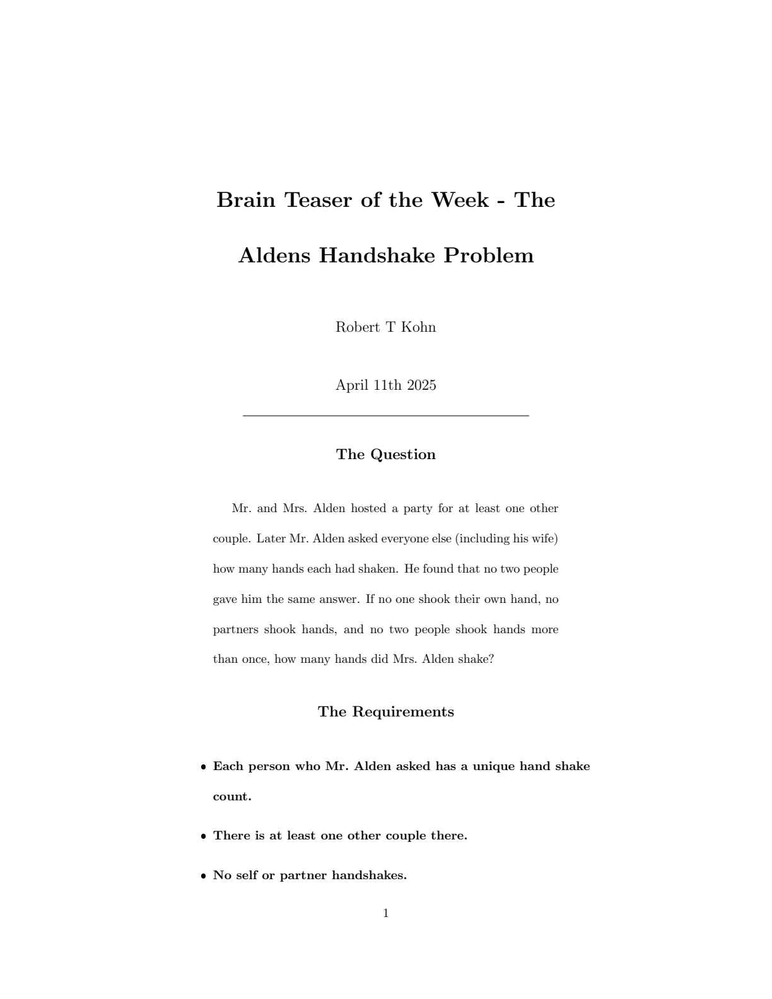
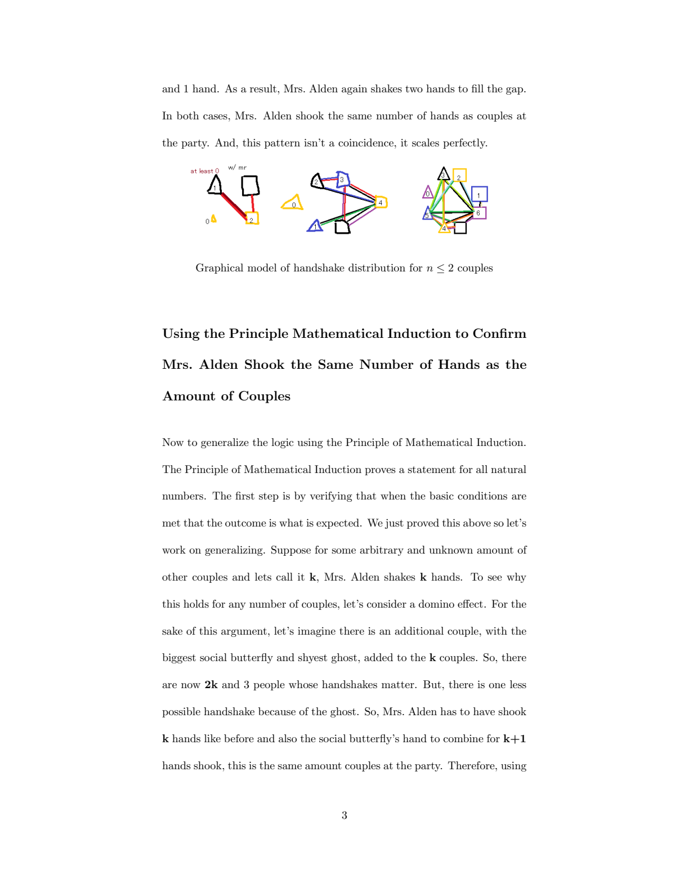

# The Alden Handshake Problem

A short mathematical essay and proof for the Alden handshake problem, completed for MTH 240 at Muhlenberg College.

## Problem Summary

Mr. and Mrs. Alden host a party with $n \geq 1$ other couples. No one shakes their own hand, spouses do not shake hands, and no one shakes hands with the same person twice. When Mr. Alden asks everyone else how many hands they shook, every answer is different. The paper shows that Mrs. Alden shook exactly $n$ hands.

## Preview

<p align="center">
  
  
</p>

## Contents

- Narrative explanation for general audiences
- Base cases ($n = 1$ and $n = 2$)
- Inductive step for arbitrary $n$
- Diagram of handshake interactions

## Tools

- LaTeX (pdfLaTeX)
- Packages: `amsmath`, `amssymb`, `amsthm`, `geometry`, `graphicx`, `caption`

## Files

- `main.tex` — paper source
- `alden_handshake_essay.pdf` — compiled PDF
- `figures/alden_handshake_model.png` — diagram of handshake cases

## Compilation

```bash
pdflatex main.tex
```
