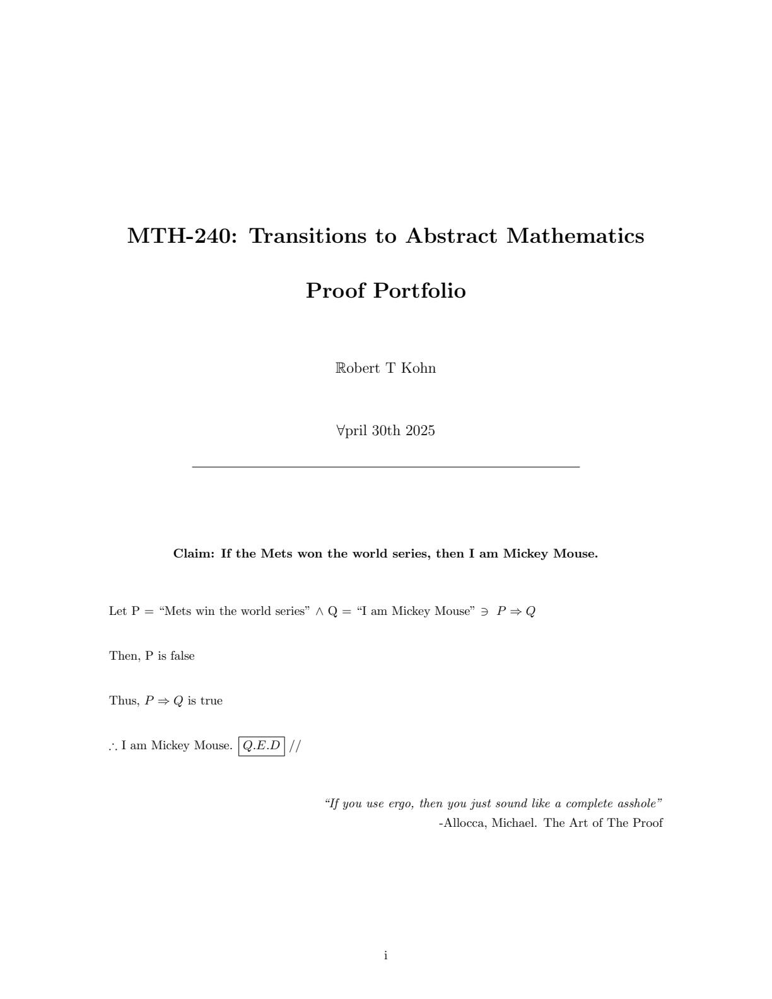
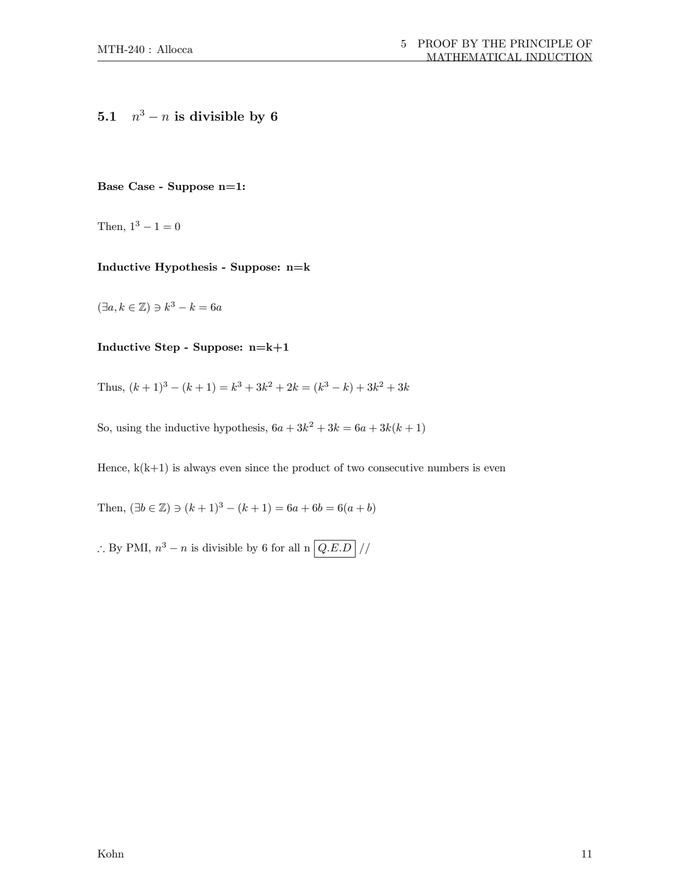

# Proof Portfolio

Final proof portfolio for MTH 240 (Transition to Abstract Mathematics) at Muhlenberg College (Spring 2025).

The document compiles revisions of 15 proofs worked on throughout the semester, along with personal reflections on proof writing and learning LaTeX.

## Preview

<p align="center">
  
  
</p>

## Contents

- Personal reflection on mathematical reasoning and LaTeX
- Direct proofs and indirect proofs (contradiction)
- Quantifiers and parity
- Multi-step set proofs
- Mathematical induction (divisibility)
- Complete induction (linear combinations and partitions)
- Number theory and Goldbach conjecture variants
- Indexed families of sets
- Equivalence relations (symmetry, transitivity, reflexivity)
- Modular arithmetic functions and bijections
- Domain of relation compositions
- Symmetric difference of sets
- The Alden handshake problem

## Tools

- LaTeX (pdfLaTeX)
- Packages: `amsmath`, `amssymb`, `amsthm`, `geometry`, `fancyhdr`, `tocloft`, `graphicx`, `caption`

## Files

- `main.tex` — main document source
- `proof_portfolio.pdf` — compiled PDF
- `figures/`
  - `alden_handshake_model.png` — diagram of handshakes for $n \leq 2$
  - `muhlenberg_mule.png` — Muhlenberg mule graphic
  - `muhlenberg_berg.png` — Muhlenberg wordmark

## Compilation

Compile twice with `pdflatex` to build the table of contents:

```bash
pdflatex main.tex
pdflatex main.tex
```
